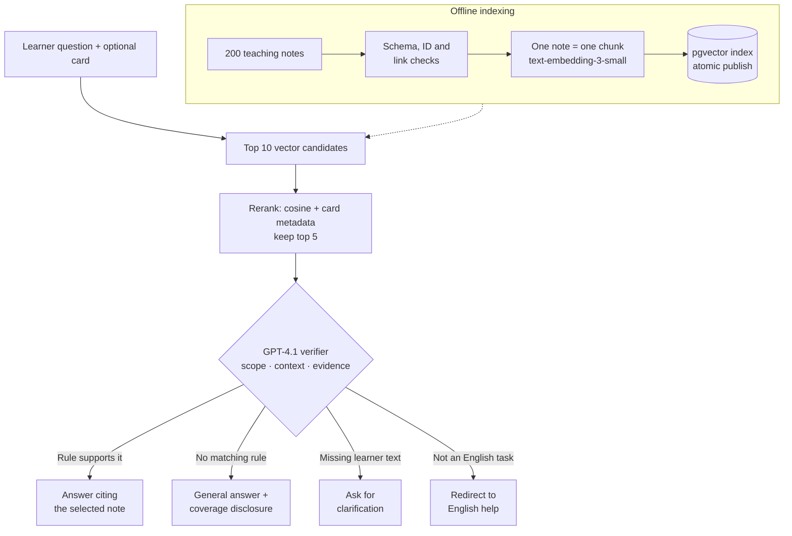

# LinguaFlow

**An English tutor that explains why a rewrite works, with teaching references learners can inspect.**

Built with Next.js, FastAPI, LangGraph and PostgreSQL/pgvector. The engineering focus is the RAG pipeline: reliable data, relevant references, explicit fallback behavior and reproducible evaluation.

[Try the demo](https://linguaflow-demo.vercel.app) · [Engineering case study](docs/RAG_ENGINEERING_CASE_STUDY.md) · [Evaluation results](docs/EXPANSION_EVALUATION_RESULTS.md)


[Product walkthrough with narration](docs/demo/english-study-demo.mp4) · [AI engineering walkthrough](docs/demo/ai-system-walkthrough.mp4) · [Screenshots, chapters and captions](docs/demo/README.md)

*Recorded from the live interface: complete a practice question, review feedback, then study a card and read a real AI explanation with its teaching reference. The MP4 includes narration and synchronized subtitles; the GIF runs at 20 fps. Loading gaps are edited. [Capture details](docs/demo/english-study-capture.json).*

## The problem

A fluent explanation can still teach the wrong rule. Changing “I may finish” to “I have finished,” for example, changes both certainty and completion. A tutor should explain that distinction, cite a relevant rule when available, and ask for context when the learner has not supplied enough information.

LinguaFlow combines timed drills, conversational coaching and study cards. Learners can ask for explanations, see the selected teaching reference, and rate the response. A session planner recommends what to practice next.

**Why RAG?** It makes the teaching curriculum editable and its source choices inspectable. At 200 teaching notes, retrieval with a verification step lets every explanation point to the specific rule it relied on.

## What I built

| Area | Implementation and reasoning |
|---|---|
| **Data pipeline** | 171 canonical English drills and 200 teaching notes, with examples, counterexamples and 114 external reference records. Validation checks IDs, relationships and content structure before indexing. |
| **Retrieval** | One concept per chunk; `text-embedding-3-small` embeddings; pgvector candidates reranked with card metadata. Short notes keep rules and qualifications together. |
| **Source and context checks** | One bounded verification call checks task scope, missing learner text and evidence support. Uncovered questions get an explicit disclosure; incomplete questions get clarification. |
| **Index reliability** | Atomic publication and corpus/model fingerprints prevent partial or incompatible indexes from being served. Provider and index failures return explicit errors. |
| **Evaluation** | Separate retrieval, answer-quality and latency/token/cost metrics. Frozen plans, saved outputs and offline replay keep experiments inspectable—including failed attempts. |

See the [200-note catalogue](agent/knowledge/en/README.md) and [expansion status and evaluation plan](docs/CORPUS_EXPANSION_200.md).

## Measured results

**200-note corpus, 100 paired synthetic questions:** the same questions run through raw hybrid retrieval and through the full pipeline with source and context verification.

| Measure | Raw retrieval | With verification |
|---|---:|---:|
| Selected references that were correct | 35.6% (32/90) | **86.4% (51/59)** |
| Supported questions that received a correct reference | 53.3% (32/60) | **85.0% (51/60)** |
| Answer correctness, judge score 0–4 | 3.37/4 | **3.98/4** |
| Answers judged to contain hallucination | 14/99 | **1/100** |
| False references on missing-context questions | 15/15 | **1/15** |
| Local pipeline p95 latency | 2.22 s | 3.20 s |
| Mean pipeline token cost | $0.00011/request | $0.00407/request |

**312 Python tests passed, zero skipped**, including disposable PostgreSQL/pgvector integration. CI also runs web lint, type checks, tests, build, guest browser tests and evaluation replay.

Confidence intervals, cost breakdown, failure audit and the earlier 31-note release results are in the [full evaluation report](docs/EXPANSION_EVALUATION_RESULTS.md).

## How it works



The verifier only picks an evidence ID; the backend then inserts that note's exact text, so learners see the real source, never a model paraphrase. Coverage disclosure is added by the backend, not left to the prompt. Index, embedding or verification failures return an explicit 503 instead of silently answering without a source. [Read the design decisions and trade-offs →](docs/RAG_ENGINEERING_CASE_STUDY.md)

## Try it

Open the [demo](https://linguaflow-demo.vercel.app) and choose **Start practicing** for five English questions. Open **Ask Coach** after an answer, or go to **Study**, select a card and choose **Study selected** for explanations with teaching references. Guest mode requires no account.

## Explore the engineering

| Interested in… | Start here |
|---|---|
| Problem, architecture and design trade-offs | [Engineering case study](docs/RAG_ENGINEERING_CASE_STUDY.md) |
| Data selection, cleaning and provenance | [Dataset card](docs/DATASET_CARD.md) |
| Metrics, failure analysis and reproducibility | [Evaluation report](docs/EXPANSION_EVALUATION_RESULTS.md) |
| Running the app and tests | [Local development](docs/LOCAL_DEVELOPMENT.md) |
| Hosting, migrations and operations | [Deployment runbook](docs/DEPLOYMENT.md) |

## Run locally

For the guest web app, with Node.js 20+ and pnpm:

```bash
pnpm install
pnpm dev
```

Open [localhost:3000](http://localhost:3000). AI features need the Python agent and provider configuration; freeform RAG also needs a published pgvector index. See the [setup guide](docs/LOCAL_DEVELOPMENT.md).

---

<sub>The demo backend runs on a free host and may take a moment to wake up. [Deployment evidence](docs/RELEASE_EVIDENCE_STATUS.md) lists the verified backend revisions.</sub>

[MIT License](LICENSE) · JL200126
